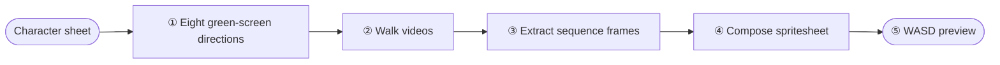
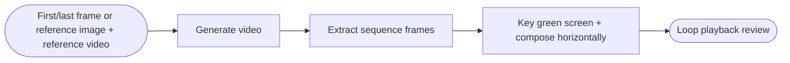

English | [中文](https://github.com/universe-st/dsh-game-material-master/blob/main/README.md)

# Game Material Master

**Start from a single character sheet and batch-produce the assets your game actually needs.**

Volcengine Ark **Seedream** handles image generation, **MiniMax** (or a local **ComfyUI**) handles
image-to-video, and keying, frame extraction, pixel quantization and spritesheet composition all happen
locally through `ffmpeg` — no system image libraries required, and your assets are never uploaded to a
third-party service.

[](https://www.npmjs.com/package/dsh-game-material-master)
[](LICENSE)

> **🆕 0.11.0 update**: both map editors gain a full **Agent loop** — `mapInspect` / `isoInspect` read cells,
> objects, stamps, markers and passability by region, while `mapRender` / `isoRender` synchronously produce a
> **check image** (region crop, zoom, optional marker / grid / passability / outline overlays) and return a local
> absolute path for `read_image`. `applyMapOps` / `applyIsoOps` add **`dryRun`** (validate without writing) and
> **`ifRevision`** (reject stale writes instead of overwriting newer edits). Markers carry **kind / color / note /
> tags** (`marker update`; export formats move to `@5` / `@2`); stamps can be **moved / rotated**, the minimum
> footprint drops to **1×1**, and passability can be **repainted from the asset properties**; 45° objects can be
> **duplicated**; tile imports accept a **local path**; every project / task has a **Copy ID** button. Also fixes
> the multi-cell stamp brush leaking into marker / eraser tools. Wire methods 184 → **188**, new
> `verify-map-agent` self-check.
>
> **0.10.0 update**: the conversational surface is now a single **`game_material`** tool
> (`action` picks `guide / intake / call / status / wait / review / approve / reviewMode / upload`).
> The always-resident context drops from **49 KB to about 4 KB**; flows and method tables are loaded on demand
> through `action:"guide"`. Module ⑤ is replaced by a fully local **45° isometric map editor** (2:1 diamonds,
> 4×4 auto-tiling, multi-cell / elevated objects, animated tiles, markers, wraparound, one-click generation,
> plus **Generate with AI** which opens a chat and links the result back into "Add tileset" for confirmation).
> A new **optional ToAPIs asynchronous image / video backend** lands via
> [PR #7](https://github.com/universe-st/dsh-game-material-master/pull/7) — thanks
> [@ToAPIs-2025](https://github.com/ToAPIs-2025). The 0.9.x **sound-effect generator** (Seed-Audio) and its
> network-retry fixes remain. **0.10.1** fixes a crash in the isometric editor's one-click
> **continent** generation (the height-field midpoint pass wrote to a cell that does not exist).
> See the
> [release notes in AGENTS.md](https://github.com/universe-st/dsh-game-material-master/blob/main/AGENTS.md#已发布版本).


> **Up and running in 30 seconds**: `dsh plugin --profile web add dsh-game-material-master` → restart DSH →
> click "Game Material Master" in the sidebar → enter the API keys you need (images / video; sound effects use a separate speech key) → create a project,
> upload your character sheet → click "Generate turn video" (the default path: the character rotates steadily
> in place for one full turn, then the eight directions are cut out automatically; switch the method in
> stage ① if you'd rather generate each direction separately).
>
> The sidebar entry also carries a **small chevron menu button**: click it to pop up the eight features and
> jump straight into the one you want. Features you do not use can be turned off in settings (see
> "Feature management").

All eight modules share the same "generate → review → re-run" workbench. Every stage can be **redone on its
own**, and every asset can be **approved item by item**. The "review mode" lets an agent approve each step
and move on automatically, or stop at every step and wait for your go-ahead.

| Module | What it does | What you get |
|---|---|---|
| **① Eight-direction sprite sheet** | One character sheet → 8 directions × 8 frames (default "turn capture": eight directions cut from one rotation video; both videos can also be **a local file of your own**) | A walk spritesheet you can drive with WASD (every intermediate image can be saved individually or as one zip) |
| **② Image generation** | Prompt (optionally with reference images) → images → green-screen keying | Clean transparent PNG character art / props |
| **③ Sequence frames** | First/last frame or a reference video → generate video → extract frames → key | A horizontally laid out, loopable sequence |
| **⑤ 45° map editor** (**fully local, zero cost**) | Import your own 45° diamond tiles (or use the built-in set) → paint ground / auto-connecting tiles / multi-cell objects / markers on a 2:1 isometric canvas → export. The assets card also has **Generate with AI** for ground / object assets (new chat → host assembles → click the link to confirm; 4×4 autotiling is not AI-generated in v1). Asset properties are fixed at import time (object size can be previewed against the cells and adjusted while adding); afterwards only name / playback speed / loop mode can change. Built-in set: grass, dirt, stone, water, shoreline autotile, tree / rock / bush / barrel / stone house | PNG + save-file JSON (isometric grid, auto-connect, animated tiles, multi-cell objects, markers, passability); tick what to export and multiple files come as one ZIP |
| **⑥ Top-down map editor** (**fully local, zero cost**) | Pick a tileset → paint directly (rebuilt after AsLib's RPG Map Maker: one screen, icon-only, no jargon; three default layers — terrain / decor / buildings — that you can rename and reorder; a **marker layer**: one nameable marker per cell, drawn as a numbered circle; **Generate with AI** lives in the assets window: give a prompt, a name, a frame count, a method and a usage, and the plugin **opens a new chat** to generate it — it picks the tile type (plain / whole-cell / quadrant) from the prompt itself, asks the model for **one seamless tile** and assembles all 16 connections / 5 shape rows in code (so the tiles actually line up on the map). Animated assets use quadrant tiles (frames become variants, still auto-connecting) or plain tiles (flipbook), and each asset can be given its own playback speed in "Add asset" (otherwise it follows the global speed in Settings) plus a **clarity** mode for the 2K-to-32px downscale (area average / nearest / average + sharpen) , a **loop mode** (forward / reverse / ping-pong), and **stamps** (one picture stamping N x M cells at once - statues, murals, carpets - rotated with a right-click, green screen keyed to transparency, with per-cell walkability set at import), a **tile size** choice when creating a project (16 / 32 / 48 / 64 - pick 48 / 64 for sharper AI assets) and automatic trimming of the white border models like to add; whole-cell tiles are just 16 connection cases with no animation, so the dialog locks the frame count and the video model, then posts a link; click it and the image and its usage are already filled in on "Add asset") | PNG + save-file JSON (wrapping map, auto-tiling, animated tiles, markers); tick what to export and multiple files come as one ZIP download |
| **⑦ Music generation & editing** (Puyue AI) | An inspiration prompt or full lyrics → a new chat that is **not attached to any project**; the agent there reads the built-in creation guide, expands the prompt, chooses Suno / Mureka / MiniMax / ACE-Step and a mode, generates → back in the UI, trim / adjust gain / fade / normalize → save versions and export. Also **Compose mode**: analyse the idea, present a style/key/section/instrumentation plan, write MIDI with scoremill, render a local preview, revise version by version, then optionally hand it to Suno | MP3 / WAV / M4A (multiple outputs can be zipped); compose mode also exports a score bundle (MIDI / preview / plan / compose.py). The original is kept and every edit or score version is new |
| **⑧ Sound effects** (Volcengine Seed-Audio) | Describe the source / environment / intensity / duration → sound effects, ambience, UI sounds, creature roars or character voices; optionally 1 reference image or up to 3 reference audio clips (mutually exclusive); every run adds a take without overwriting earlier ones | WAV / MP3 / Ogg Opus; export one take or zip all. Up to 120 seconds per run; every generation is billed |
| ~~④ Rigged animation~~ | Part extraction → assembly → skeletal animation → Spine / DragonBones atlas | **Experimental, not covered in this document** |

> 💡 **Module ⑤ "45° map editor" gets its geometry from code and its content from your images.**
> The 2:1 step, diamond placement, object base centre and occlusion order are all computed on the host;
> the UI only executes the drawing plan, so preview and export cannot drift apart. Auto-connect is an exact
> 4×4 = 16 tile layout (N/E/S/W bits), objects may rise above their cell (tree canopy / roof), and ground,
> markers and auto-connect neighbours wrap around the edges.
> **Not a single model call — completely free.**

> 💡 **Module ⑥ "Top-down map editor" is modelled after the RPG Map Maker in [AsPJT/AsLib](https://github.com/AsPJT/AsLib/tree/master) and rebuilt as one screen, icon-only, with no jargon.**
> The asset palette and twelve icon buttons sit on the left, the canvas on the right. **Pick one tileset image and start
> painting**. "Assets" opens a **list of images plus an "Add image" button**: the dialog asks for the
> **image file / name / cell size / usage / animation** (hover any control for an explanation) and the properties
> are then **fixed for good -- delete the image and add it again to change them**. Leave the cell size empty and
> it is detected from the image. The built-in set (4 autotile sheets + 1 prop grid, the water animating on 2
> frames) is in the list by default, can be deleted just like your own, and "Restore built-ins" brings it back;
> its properties cannot be edited. Not sure how your own image should be laid out? The "**How to lay out an
> image**" button at the top right of that dialog opens three illustrated pages -- plain tiles / full-cell
> auto-connect / block auto-connect -- and the grid drawn over each example hides and reappears in a loop, so
> the columns, the rows and which tile is which are obvious at a glance. To animate **your own plain sheets**, pick "**Flip-book**" when adding (one
> row per page); autotile sheets need no setting -- their variants are the frames, and the list shows
> "Animates: N frames". Map size and cell size are both free-form; the map **wraps around on all four sides** at
> the data level (auto-tiling joins the top/bottom and left/right edges). The canvas cannot be dragged off the
> map — it stops at the edge and the map's top-left lines up with the canvas — and the blank area outside cannot
> be painted
> ("try the built-in tileset" — its water already has a 2-frame animation). To animate **your own plain
> sheets**, pick "**Flip-book**" under "Does it animate?" in the Assets card: like a flip-book, each row is one
> page, and the card states the result ("Animates: N rows = N frames"). Autotile-block sheets need no setting —
> their variants are the frames. You can also generate random terrain, a maze or a continent in one go.
> **Not a single model call is made — so nothing is billed.**

> 🏷️ **Creating anything in any of the eight modules asks for a name first**: the field is pre-filled with the
> default (just press Enter to keep it), and cancelling creates nothing. Map projects can also be renamed later.

> ⚠️ **Module ④ "Rigged animation" is still experimental and not yet finished**: the quality of part extraction
> depends on the image model, automatic assembly and bone inference frequently need manual correction on real
> character art (agent visual priors or manual dragging), and the exported Spine / DragonBones output has not
> seen enough engine-side validation. The module carries an "experimental" badge in the UI and shows a dialog
> every time you enter it. This document only covers the first three modules.
> If you need it — or want to help make it solid — you're welcome to join in at the
> [GitHub repository](https://github.com/universe-st/dsh-game-material-master).

---

## ① Eight-direction sprite sheet

Feed in one front-facing character sheet and get all eight directions in one pass:
**green-screen images → walk videos → sequence frames → final spritesheet → interactive preview**.



### The two generation methods: turn capture (default) / per-direction generation

There are two ways to produce the eight direction images, and the output is identical either way
(`images/<direction>.png`), so the next four steps don't change:

| | **Turn capture (default)** | Per-direction generation (alternative) |
|---|---|---|
| How | Generate **one** green-screen video of the character turning steadily in place for a full rotation, then cut frames for the eight directions along the timeline | Generate each of the eight directions separately, in dependency order |
| Cost | One video call | Eight image calls |
| Consistency | **All eight directions share one source**: same character, same lighting, same art style | The model has to re-interpret the character every time, so face shape, hair color and clothing tend to drift |
| Adjusting position | The timeline has **eight draggable circles** — drag to a frame and that frame is cut (re-cut locally, free and instant) | Regenerate each image |

The row of circles in the UI is the capture position for each of the eight directions, and the thumbnail
strip below it is the candidate frames for the whole rotation — drag against the picture and release to
re-cut that one image (this also invalidates that direction's walk video and sequence frames automatically,
so old and new orientations never get mixed together). The default positions assume an even split
"starting from the front, one full rotation at constant speed"; when the model actually turns in a different
direction or at a different pace, just drag the circles, or click "turn direction" to re-order them. Changing
the candidate frame count (8–64) re-extracts automatically and rescales any positions you have dragged.

### You can also use **a video from your own computer** (steps ① and ②)

Neither of the two "generate a video" places only has the "call the model" path: when you already have a
suitable video, click **Choose a local video** and pick it — the result is identical to a generated one and
the later steps work exactly the same.

- **Step ① · turn video**: pick a chroma-key video of the character turning a full circle in place; the plugin
  extracts the candidate frames and cuts out the eight directions **immediately**, then you just drag the
  circles to adjust positions.
- **Step ② · the walk video of one direction**: each cell can pick its own file (fixed camera, walking in
  place), and step 3 "extract all sequence frames" still applies.
- MP4 / MOV / M4V / WebM / MKV / AVI are supported (detected by **file header**, not by extension), up to
  100MB each; this path is processed locally with ffmpeg and is never uploaded to any model.
- Replacing a video invalidates the frames and sheet already derived from it, so frames from the previous
  video can never leak into the new one.

### Every intermediate image can be saved

**Every image** produced along the way can be saved: the eight chroma-key images, the turn candidate frames
and the full-rotation strip, the chroma-key frames and manual-pick candidates extracted from each video, the
keyed frames, and the final sheet. Every product you can see in the UI has a "Save" link; since one candidate
extraction produces 32–64 images at once, the bottom toolbar also has **Save all images (zip)** — one archive
laid out like the project directory (`images/…`, `turn/…`, `frames/…`, `keyed/…`, `out/sheet.png`).
The generated videos (the turn video and the eight walk videos) each have a "Save video" link too.

### How to use it

1. **Create a project → upload a character sheet**, then write your prompts (turn capture uses **one turn-video
   prompt**; per-direction generation uses one prompt per direction, plus a shared "common suffix prompt" for
   all eight).
2. **Generate turn video** (the default path): the character rotates steadily in place for one full turn
   against a green screen. Once the video arrives, the plugin extracts candidate frames and cuts out the eight
   directions automatically — you usually don't need to touch anything. **Per-direction generation** (the
   alternative) is **generate all in one click**: the eight directions produce green-screen full-body images in
   dependency order. Per image you can see the elapsed time and which model was used; if you don't like one,
   **regenerate** that image, or expand **edit prompt** to change just that one.
3. **Generate all videos**: make the character walk three steps in place in each direction. This is the most
   expensive and slowest step (1–6 minutes per clip).
4. **Extract all sequence frames**: each video is sampled evenly across its duration; uniform cropping, scaling
   and **pixel-art quantization** all happen here too.
5. **Compose spritesheet**: remove the green screen and stitch the rows into one spritesheet; drag rows with
   ↑↓ to reorder, and you can save parameters before composing.
6. **Walk preview**: drive the character with WASD or the arrow keys — whether the eight directions blend
   smoothly is obvious at a glance.

### ① Eight green-screen directions

**Turn capture (default)**: one green-screen video of "a steady full rotation in place", cut into eight
directions along the timeline; the eight circles on the axis are their capture positions — drag to change
them and release to re-cut instantly (locally, free).


**Per-direction generation (alternative)**: each of the eight directions is generated separately; single
images are sharper, which suits cases where you only need a few directions or want maximum per-image quality.


### ② Walk videos


### ③ Extract sequence frames


### ④ Key green screen and compose spritesheet


### ⑤ Walk preview


> **Re-running a single step**: if any step isn't right, redo just that step — a single direction or a single
> stage — instead of starting the whole batch over.

---

## ② Image generation

Generate images from a prompt, with optional reference images. After generation the green screen is
**keyed automatically** into a transparent PNG — or you can upload an existing image and run only the keying,
without spending anything on generation.

### How to use it

1. Write the main prompt; put requirements you reuse across batches (for example "no text watermarks") into the
   **common suffix prompt**.
2. Optional: drop in **reference images** (up to 10); with references present, it runs image-to-image. To cite
   several of them, refer to "image one", "image two" in the prompt.
3. Pick the model / size / count and click **Generate**.
4. In the results area, review **image by image**: approve, download the original / download the PNG (the keyed
   result), regenerate, delete. The background percentage is shown right there so you can judge how clean the keying is.


---

## ③ Sequence frames

A more "one shot" path than the eight-direction sheet: give it a first-frame image (or a reference image plus a
reference video) and it generates a looping motion directly, then extracts frames, keys them, composes them
horizontally and **plays the loop in place for preview**.



### How to use it

1. Pick a mode — the platform makes the two mutually exclusive:
   - **First/last frame mode**: one image as the starting frame (the last frame is optional);
   - **Multimodal reference mode**: reference image + reference video, used to constrain style and motion.
2. Write a prompt, pick the model / duration (4–15 seconds) / resolution, and click **Generate video**.
3. **Extract sequence frames**: frame extraction, uniform cropping, pixel quantization.
4. **Green-screen keying and composition**: tune the keying parameters and compose the horizontal strip; the
   preview area on the right plays it back in a loop at the frame rate — **whether the motion flows and whether
   the keyed edges stay stable is immediately visible in playback**.
5. **Review**: approve each of the three steps.


---

## ⑦ Music generation & editing (Puyue AI)

This module does not produce a song from a single button click. You enter an idea or paste a full set of
lyrics and click "Generate and open chat"; the plugin creates a music job, then opens a **new chat that is not
attached to any project** and sends the job id plus your original text as the first message. The agent in
that chat:

1. reads the built-in **music creation guide** (style-prompt structure, the 13-point lyric QC, choosing
   Suno / Mureka / MiniMax / ACE-Step, generation-setting heuristics, game loops / short cues / loudness
   targets);
2. expands and structures the prompt; if you supplied full lyrics, the lyrics are authoritative and only
   line breaks, section tags and pronunciation get minimal fixes;
3. chooses an engine and mode for the use case (Suno `chirp-v6` by default; ACE-Step for instrumentals or a
   fixed BPM) and submits the generation;
4. waits for the platform, then optionally post-processes locally and for free (trim / gain / fades /
   loudnorm);
5. posts the tool's `openUrl` as a Markdown link.

Clicking the link returns to the music page: preview (the asset route supports Range, so seeking works),
waveform, trim, gain, fades, normalization to -14 LUFS / -1 dBTP, save as a new version, and export to
MP3 / WAV / M4A (multiple outputs are zipped automatically). The original is never overwritten. Generation is
billed by Puyue AI credits; the plugin does not collect payment and never re-submits just to check status.

### Compose mode (local MIDI; composing and previewing are free)

The New Music card has a **"Compose mode (local MIDI)"** tab. It does not ask an audio model for a song.
Instead:

1. the agent in the chat analyses your idea: use, emotional arc, style, key and tonic, BPM, meter,
   section map, instrumentation, motif;
2. it **writes the plan in your language and shows it to you first**, then saves it with
   `saveMusicScorePlan` (manual review mode stops here for confirmation);
3. it writes a `compose.py` using [scoremill](https://github.com/CharlesCNorton/scoremill) (MIT, text
   notation → MIDI), and the plugin runs it locally to produce `score.mid`;
4. the host parses the MIDI and renders a preview with **FluidSynth + SoundFont** (or the built-in synth
   when those are missing);
5. back in the UI you can preview every version, see its waveform, download the MIDI / preview, mark it
   approved, and export a score bundle (MIDI + preview + `plan.md` + `compose.py`);
6. when you say "too loud / too slow / too many drums / the second section is too long", the agent changes
   only that section; **every revision is a new version**, old versions are kept;
7. when you are happy you can click **"Generate a Suno version from this audio (billed)"**. The plugin first
   **uploads this version's preview audio** to Suno as a reference (standard upload is free), then generates a
   **cover**. Suno does not accept MIDI files, but it does accept audio, so the chain is
   "MIDI → rendered audio → upload → cover"; this stays much closer to your instrumentation and sections than
   text tags alone. If Suno flags the audio as copyrighted, you'll be asked to confirm the paid copyright
   channel. The result is still a re-performance, not note-for-note.

**Dependencies** (the plugin detects them and lets you set paths under Settings → Game Material Master →
Compose mode):

- `python3 -m pip install scoremill` — required to write MIDI;
- `fluidsynth` plus a `.sf2` (looks for `~/Library/Audio/SoundFonts/FluidR3_GM.sf2` by default) — optional,
  for a better preview;
- `ffmpeg` — for MP3 conversion / export (the music module already needs it).

Composing, previewing and exporting are fully local and **do not consume Puyue AI credits**; only the final
Suno handoff is billed.

## ⑧ Sound effects (Volcengine Seed-Audio)

This module generates directly in the UI: describe the sound, choose a format and sample rate, then click
Generate (billed).

- **Write the prompt like a dubbing director's script**: source + environment + intensity/rhythm + approximate
  duration, e.g. "metal impact in heavy rain, short and forceful, about 1 second, with a slight tail". Up to
  **120 seconds** per run; the API has no duration parameter, so put the length in the prompt.
- **Optional references**: one reference image (image-to-audio) or up to three reference audio clips (each at
  most 30 seconds / 10MB), never both. Reference audio is addressed as `@音频1…@音频3` in the prompt.
- **One take per run**: earlier takes are never overwritten; preview, export or zip them in the UI. Failures are
  not retried automatically.
- **Default model** `seed-audio-1.0`, default output WAV / 24000Hz (switchable to MP3 / Ogg Opus and
  16k / 24k / 32k / 44.1k / 48k).
- **The key is the speech console API key** (header `X-Api-Key`), **not** the Ark `ARK_API_KEY`; the
  `seed-audio-1.0` model must be enabled in the speech console. "Test connection" really generates one very
  short sound effect, which costs a small amount.
- Billing uses the returned `original_duration`; retries are billed again, so confirm with the user first.
- v1 does not edit audio locally (trim / fade / loudness); it only generates, previews, downloads and exports.

## Driving it from chat

**Every feature of all eight modules** (including the experimental rigged animation and the fully local 45° map editor) **is available through
chat**. The plugin registers exactly **one** tool, `game_material`: first read the guide for the topic, then call the
methods it lists. Detailed workflows, method tables and parameters are loaded **on demand**, so unrelated tasks do
not pay for them in context.

| action | What it does |
|---|---|
| `guide` | Read the manual: `overview` / `workflow` / `config` / `methods` / `ai-asset` / `map-agent` / eight module topics |
| `intake` | **Step 0 of the fixed workflow**: nail down the key parameters and review mode before doing anything |
| `call` | Universal channel: every remote method of the plugin is individually callable (`{method, payload}`) |
| `upload` | Upload assets by local file path (character sheet / reference image / first and last frames / parts…) |
| `reviewMode` | Record the review mode: `auto` approves automatically / `manual` requires human approval at each step |
| `status` | See the current progress and which step to do now |
| `wait` | Block until "no task is running"; what comes back is a reviewable state |
| `review` | Produce a **review package**: absolute URL, status, approval flag and deep link for every asset |
| `approve` | Approve / un-approve |

For example:

```js
game_material({ action: "guide", topic: "sprite" })        // read the sprite guide first
game_material({ action: "intake", module: "sprite" })     // ask for parameters and review mode
game_material({ action: "call", method: "runTurnVideo", payload: { projectId } })
game_material({ action: "wait", module: "sprite", id: projectId })
```

The map editors also expose an Agent loop — inspect state, draw, render a check image, then read it:

```js
game_material({ action: "call", method: "mapInspect", payload: { projectId, region: { r0: 0, c0: 0, r1: 16, c1: 16 } } })
game_material({ action: "call", method: "mapRender", payload: { projectId, region: { r0: 0, c0: 0, r1: 16, c1: 16 }, overlay: { markers: true, grid: true } } })
// pass the returned localPath to read_image; use isoInspect / isoRender for the 45° editor
```

The old per-tool registrations (`game_material_call` / `game_material_status` / …) have been merged into this single
tool; see [docs/ENGINEERING.md](docs/ENGINEERING.md#对话调用agent-也能驱动整条流水线) for the migration mapping.

Review links are **deep links**: an `openUrl` posted by the agent in its reply takes you straight to the
matching plugin page when clicked, landing on the right module / project / stage without any navigating
on your part.

Every project / task header also has a **Copy ID** button (side-list rows show `⧉`); one click copies
the `projectId` / `jobId` to the clipboard so you can paste it to the agent.

---

## Installation

```bash
# install from npm
dsh plugin --profile web add dsh-game-material-master

# install from a local directory (during development)
dsh plugin --profile web add /path/to/dsh-game-material-master
```

The package is published to npm: [dsh-game-material-master](https://www.npmjs.com/package/dsh-game-material-master)
(currently `0.11.0`, `latest`). It has no runtime dependencies, so `dsh plugin add` is all you need.

**DSH version**: `>=0.2.0-rc.2 <0.3.0` (the `engines.dsh` field; since DSH 0.2.1 the plugin manager checks it first).
When a Web deployment uses `--public-url https://host/prefix/`, deep links and asset URLs include that path prefix.

After installing, **restart DSH** (the host half is loaded at startup). The browser half is read from
`lib/client.js` on disk on each request, so refreshing the browser is enough for it to take effect.

**Dependencies**: `ffmpeg` / `ffprobe` must be reachable. They are looked up in this order:
`FFMPEG_PATH` / `FFPROBE_PATH` environment variables → the same names in the Windows registry →
common install locations (WinGet / Scoop / Chocolatey, `C:\ffmpeg\bin`) → `PATH`
(macOS: `brew install ffmpeg`). So on Windows an ffmpeg installed but never added to `PATH` still works,
and a path set with `setx` that "still cannot be found" after a restart is normal — `setx` only writes
the registry and already running processes never inherit it, so the plugin reads the registry itself.
The package has **no runtime npm dependencies** — `zod`, `cordis` and friends all resolve from DSH's own
installation tree.

> When upgrading from the older `dsh-8dir-sprites`, the first startup migrates the data directory
> automatically and your existing projects carry over seamlessly.

## Configuration

**Settings → Game Material Master**:


| Item | Description |
|---|---|
| Image backend | Pick **Volcengine Ark Seedream** (default) or a **custom image model**; switching here redirects every image-generating module |
| Volcengine Ark API Key | "Test connection" really generates a 1K thumbnail (a small charge) and validates both the key and the model |
| Image model | Defaults to `doubao-seedream-5-0-flash-260915`; switchable to 5.0 Pro / Lite / 4.5 |
| Custom protocol | One of `OpenAI API` / `ComfyUI API` / `Stable Diffusion WebUI API`; just give the host root URL |
| Custom parameters | Model name, output size (width x height), negative prompt, steps / CFG / sampler, img2img denoising, seed, timeout |
| ComfyUI workflow | Paste the whole JSON from "Export (API)"; placeholders `{{prompt}}` `{{width}}` `{{seed}}` `{{image}}` and friends are supported, and a workflow with none runs as-is |
| MiniMax API Key | "Test connection" is free and can tell an invalid key apart from other errors |
| Video model | Defaults to `MiniMax-H3` (v2 protocol); Hailuo / I2V use v1; the UCloud version of H3 is selected explicitly |
| Base URL | Host root, without `/v1` or `/v2`. `api.minimax.cn` in mainland China, `api.minimaxi.com` internationally |
| Output size | Default for every image-generating module; accepts `1K` / `2K` / `4K` or `width x height`. An image task can switch its size source to Custom to affect only that task; tasks that follow the global value update with this setting |
| Key background color | Pure green `#00FF00` by default; switch to magenta / blue / white / black when the character wears green. "Green screen / #00FF00" in generated prompts is replaced accordingly, and every keying entry can pick its own color |
| Default parameters | Cell width and height, frame count, pixel block size, keying threshold, and so on |
| Local ComfyUI (image-to-video) | Routes image-to-video through a local **ComfyUI** instead of MiniMax; "Test connection" is read-only and free |
| Music generation (Puyue AI) | Puyue AI API key, base URL, default music model and timeouts; "Test connection" reads one page of history and does not generate anything (no generation credits). Generation is billed by platform credits; the plugin does not collect payment |
| Sound effects (Volcengine Seed-Audio) | Speech console API key (not the Ark key), base URL, default model `seed-audio-1.0`, default format / sample rate and timeout; "Test connection" really generates one very short sound effect (small charge) |
| Feature management | Per-module switches: a disabled module disappears from the UI **and the agent cannot call it either** (see below) |

Keys are written only to `<DSH_HOME>/game-material-master/config.json` on your machine, and the UI always
masks them when displaying them back. **The image backend and model are plugin-level settings shared by
every module that generates images**; after you switch, tasks align to the new tier automatically.
Image-to-video always goes through MiniMax and is unaffected by the image backend.

### Custom image backend

Besides Volcengine Ark you can plug in **your own image service** (Settings → Game Material Master → Image backend):

| Protocol | Text-to-image | With reference images | Notes |
|---|---|---|---|
| OpenAI API | `POST {base}/images/generations` | `POST {base}/images/edits` (falls back to the `image` field of generations when the endpoint does not exist) | Works with OpenAI itself and compatible gateways; both `b64_json` and `url` responses are accepted |
| ComfyUI API | `POST {base}/prompt` → poll `/history` → `GET /view` | `POST {base}/upload/image` first, then the file name goes into the workflow | Needs an **API-format** workflow JSON; when `{{image}}` is absent the `LoadImage` node is patched automatically |
| Stable Diffusion WebUI API | `POST {base}/sdapi/v1/txt2img` | `POST {base}/sdapi/v1/img2img` (`init_images` + denoising strength) | WebUI must be started with `--api`; an API key of `user:pass` uses HTTP Basic |

Local servers usually need no API key; enter the **host root** (for example `http://127.0.0.1:8188`) and the
plugin appends the protocol-specific endpoint. Hit "Test connection" to really generate one test image and
prove the whole path works.

### Local ComfyUI (image-to-video)

If you would rather not use MiniMax, or you want to run your own model, **image-to-video** can be
routed to a local [ComfyUI](https://github.com/comfyanonymous/ComfyUI): tick "Local ComfyUI
(image-to-video)" in the settings, set the address (default `http://127.0.0.1:8188`) and paste a
workflow JSON — either the API format or the UI format the editor saves directly.
Image generation, keying, frame extraction and composition are unaffected — the same downstream
pipeline as MiniMax.

- **Both formats are accepted**: the API format exported by `Workflow → Export (API)` is the most
  direct; the **UI format** (top level holds `nodes` / `links` arrays) can be pasted as-is — the
  plugin converts it first, and the line "converted from the ComfyUI UI format (N nodes)" shows up
  under "Test connection". Notes and muted / bypassed nodes are skipped; if that JSON is so old
  that its widgets carry no `widget` metadata, the plugin tells you to re-export with Save (API
  Format) instead.
- **Injection points are detected automatically**: which node input receives the prompt, where the
  first frame goes, and which inputs override width / height / duration / seed. The detected
  bindings are shown under "Test connection". If a guess is wrong, override it by hand with
  `nodeId.inputName` (for example `1.text`).
- **First frame**: an existing `LoadImage` node is used when present. Otherwise the plugin reads the
  node definitions from ComfyUI and inserts a `LoadImage` at any declared-but-unwired `IMAGE` input
  (for example `FreeVideoGenerate.first`).
- **The built-in template is the FreeVideo chain** (`FreeVideoGenerate` + `FreeVideoMedia` plus an
  empty `LoadImage`, with the first frame wired to `FreeVideoGenerate.first` — the same wiring as the
  official
  [FreeVideo-All-in-One.json](https://github.com/FlashML-org/FreeVideo/blob/main/example_workflows/FreeVideo-All-in-One.json)).
  Broke it? Click "Restore built-in template"; the official UI-format JSON can be pasted in too.
- The output is unchanged: ComfyUI only produces the green-screen clip — **frame extraction, keying
  and composition still run locally through `ffmpeg`**.
- "Test connection" only reads the ComfyUI version, device and queue length: **no queueing, no
  generation, no cost**.
- **Cookies (optional)**: ComfyUI does not authenticate on its own; a Cookie is only needed when it
  sits behind a login-protected reverse proxy (Cloudflare Access, Basic Auth, and the like). Copy
  the whole Cookie from your browser developer tools — the plugin normalises it into a single line
  and sends it on **every** request: uploading first/last frames, submitting, polling, and fetching
  the finished video.
- The local backend does **not** support multimodal reference mode (reference images / videos) —
  that is a MiniMax v2 capability; use first/last-frame mode with ComfyUI.

### Feature management (hiding modules you do not use)

Turn a module off under **Settings → Game Material Master → Feature management**; turn it back on any time.
Existing project data is never deleted.

- **UI**: the module disappears from the workbench tabs and from the sidebar shortcut menu. If you were
  sitting on that module, the workbench falls back to the first visible one.
- **Chat**: `game_material`'s `guide` / `call` / `status` / `intake` / `upload` / `wait` / `review` / `approve` all refuse,
  and the error says where to turn the feature back on. Hiding only the UI would not be hiding at all: the
  agent cannot see the tab but could still call generation methods and spend real money, so the host half
  re-checks the current setting on every call.
- Visibility is **user-only**: the tool surface rejects `saveConfig({hiddenModules})`, otherwise the model
  could simply unhide a feature by itself.
- Hiding everything is allowed; the workbench then says every feature is hidden.

## UI language

**The plugin UI follows DSH's own language setting** (Settings → General → Language). Chinese and English are
both first-class, and switching takes effect **immediately** with no page refresh: the workbench title, the four
module tabs, every card's buttons, notice bars, dialogs and the settings page all follow along.

Implementation-wise it neither guesses nor copies DSH's language state; instead it hooks into DSH's `locale`
service (`@deepseek-ai/dsh-client-locale`): the plugin registers its Chinese/English string table there and
afterwards pulls every piece of UI text from it. If the service isn't there, nothing errors and the UI falls
back to the original Chinese.

**The built-in default prompts switch too.** The eight-direction image prompts, walk-video prompts and
turn-video prompts have English versions when the UI is in English — they really do get sent to
Seedream / MiniMax, so the language has to match the UI, otherwise you can't tell what you're tuning. The rule
is "only swap the ones you haven't edited": prompts you have edited by hand don't change a single character when
you switch languages, and "Reset to default" gives you the default for the **current** language. Prompts live on
the host side (the host has no access to the locale service), so the browser half passes the current language
along every time it reads a project or resets prompts.

Scope note: **localization covers the browser half's UI text and the built-in default prompts** — the workbench
title, the eight module tabs, every card's buttons and notice bars, dialogs, the settings page, the review
controls, and the default prompts. Two categories remain in Chinese, because DSH currently only exposes the
locale service to the browser half:

- **Lines the host writes into the run log** (the host emits Chinese, so they actually look like
  `开始生成「南 · 正对镜头」`, `「南 · 正对镜头」生成完成，用时 12.3 秒`) plus the dynamic conclusions from
  part-extraction QA;
- Text that chat tools return for the model to read (the rendering of `game_material_status` / `review`, the
  follow-up questions from `intake`).

Everything in the UI that you can click, change or approve is bilingual.

## Common pitfalls

- Don't use "silhouette" in a prompt — the image model takes it literally and paints the character as a solid
  black outline.
- Distinguish "turning" from "gaze": when writing a direction, add "rotate around the vertical axis only, gaze
  stays level", or the character ends up looking up at the sky.
- Image-to-video doesn't guarantee it will preserve a flat background (lighting can turn it into a gradient), so
  the keying doesn't rely on a single green value.
- Duplicate submissions are blocked (both in the UI and in chat) so you don't burn money for nothing.

## Where the output goes

```
<DSH_HOME>/game-material-master/
├── projects/<id>/      eight-direction sheet (source / images / videos / frames / keyed / preview / out)
├── image-jobs/<id>/    image generation
├── sequence-jobs/<id>/ sequence frames
├── rig-jobs/<id>/      rigged animation (experimental: sheet / parts / layout / rig / atlas)
├── iso-jobs/<id>/      45° map editor (project.json / map.json / tilesets / preview / export)
├── map-jobs/<id>/      map editor (project.json / map.json / tilesets / ai / preview / export)
├── music-jobs/<id>/    music generation & editing (songs / versions / peaks / tools / out)
└── sfx-jobs/<id>/      sound effects (refs / takes / out)
```

> The old "map tile generation" `tile-jobs/` directory is **no longer read** and is left on disk for manual archiving;
> the new module stores data in `iso-jobs/` with no migration.


## Development

```bash
npm run build        # tsc → lib/, and strip the trailing export from the browser bundle
npm run typecheck    # type checking only
```

Local self-checks (no network, no cost): `scripts/verify-host.mjs` (host pipeline), `verify-tools.mjs`
(chat-facing tool surface), `verify-pipeline.mjs` (frame extraction / keying / composition), `verify-client.mjs`
+ `verify-feedback.mjs` (browser-half contracts and real rendering), `verify-i18n.mjs` (Chinese/English string
table completeness), `verify-rig.mjs` (the rigging algorithm layer), and more. End-to-end scripts that hit the
real API cost money — run them only when you mean to.

### Adding a piece of UI text

The **Chinese source text you write is itself the key** in the string table, so you just write code
normally (yes, the key stays Chinese even in the English build — that is the point: the call site reads
as the copy, and a missing translation falls back to the key instead of showing a code name):

```ts
h("span", null, T("正在装配定位…"))                       // plain copy
T("第 {n0} 帧", { n0: index + 1 })                        // with interpolation; English may reorder freely
```

Then add an English entry to the string table in `src/client.ts` (between `i18n-ignore-start` /
`i18n-ignore-end`); if you miss one nothing crashes, but `verify-i18n.mjs` will catch it. To wrap legacy code
in bulk, use `node scripts/i18n-wrap.mjs src/client.ts --write` (lexical, idempotent, safe to run repeatedly).

How changes take effect after you edit code:

| What you changed | How it takes effect |
|---|---|
| `src/client.ts` (browser half) | Just refresh the browser |
| `src/*.ts` host half | Restart DSH (or hot-reload with `--patch`) |

The screenshots in this document were taken by Playwright against the real UI; the originals live in
[`docs/images/`](https://github.com/universe-st/dsh-game-material-master/tree/main/docs/images).

## Known trade-offs

- **The pixel-art look comes from post-processing** (pixel quantization during frame extraction), not from the
  prompt — Seedream ignores "pixel art"-style instructions.
- **Part-extraction quality is determined by the image model** and is the biggest bottleneck right now. The
  model occasionally "swaps the character" or splits them into clothing pieces; the most reliable path is
  "upload your own part PNGs" (the filename is the part name), which skips generation entirely.
- **Automatic assembly is only reliable when each part really is a whole limb from the reference image**; when
  real character art goes through generated part extraction, prefer correcting it with agent visual priors or
  manual dragging (neither of those steps costs anything).
- MiniMax occasionally rejects content on moderation (about 10% in practice); just reword to a more neutral
  prompt and retry.
- **Local ComfyUI timing is unpredictable**: a job may sit in your local queue for a long time, or fail
  halfway through because of VRAM. The plugin only submits and polls; the failure reason (which node,
  which exception) is reported back verbatim, but model and VRAM issues have to be diagnosed in the
  ComfyUI console itself.

## Credits

- **Module ⑥ "Top-down map editor" is modelled after the RPG Map Maker in
  [AsPJT/AsLib](https://github.com/AsPJT/AsLib/tree/master).** What was borrowed is its **interaction and
  layout** (one screen: tile palette plus an icon toolbar on the left, canvas on the right; the pen / eraser /
  bucket / pipette / hand tools together with single-layer preview, layer up-down and undo-redo; click a
  palette tile to pick a brush, a red frame marking the current one, wheel to zoom, drag to pan) and two
  **geometry conventions**:
  1. **The map wraps around** — auto-tiling works modulo the map size, so the top/bottom and left/right
     edges join up (a data-level property); the camera is clamped inside the map (dragging stops at the
     edge, with the map's top-left aligned to the canvas) and nothing can be painted outside it;
  2. **A2 auto-tiling** — a 64×160 sheet is 2 variants × 5 shapes; each cell is drawn as four 16px quadrants,
     and each quadrant is picked from one 5-state table over left / up / up-left. Both the small-cell index
     formula and the fact that "1-based index − 1 == AsLib's chip index" come from its `AsMap.hpp`.

  Its code is **CC0**; this plugin re-implements the behaviour in TypeScript and **does not copy its source**.
- **The music-creation methodology is distilled from
  [bitwize-music-studio/claude-ai-music-skills](https://github.com/bitwize-music-studio/claude-ai-music-skills)**,
  released under **CC0-1.0** (Public Domain). This plugin only absorbs the methodology (style-prompt
  engineering, lyric writing and review, Suno model selection, mastering loudness targets) and rewrites it as
  a bilingual built-in guide (`src/musicguide.ts`); it does not copy the repository's code or long passages.
  Original rights belong to its authors. With thanks.
- **Compose mode uses [CharlesCNorton/scoremill](https://github.com/CharlesCNorton/scoremill)** (**MIT**),
  a text-notation → MIDI library. The plugin does not bundle scoremill; the built-in guide absorbs its
  notation and pitfalls, and the user's/agent's `compose.py` is executed by the local Python. The product
  idea also references [XIAODUOLU/Midra](https://github.com/XIAODUOLU/Midra) ("prompt-to-code MIDI,
  editable, then decide whether to generate audio"). All rights remain with the original authors. With thanks.
- **The optional ToAPIs asynchronous image / video backend was contributed by
  [@ToAPIs-2025](https://github.com/ToAPIs-2025) in
  [PR #7](https://github.com/universe-st/dsh-game-material-master/pull/7)** (`feat(toapis)`): independent
  settings, receipts that block duplicate paid submissions, credentials kept on the host, and Ark / MiniMax
  still the defaults. Thanks for the implementation.
- ⚠️ **The `Picture/MapChip/*_pipo.png` tiles shipped in the AsLib repository belong to a third party and are
  not bundled here** (its README states "Third party content is copyrighted by its respective owners").
  The built-in tileset is generated procedurally on this machine by `scripts/make-map-sample-tileset.mjs`,
  to the same A2 spec.

## License

[MIT](LICENSE)

> Full engineering documentation (algorithm details, self-check contracts, history of pitfalls) is in
> [docs/ENGINEERING.md](docs/ENGINEERING.md).

## Optional ToAPIs image/video backend

Configure ToAPIs in settings, then select ToAPIs as the image backend and/or enable its video option. Ark/MiniMax remain the defaults; ComfyUI, custom protocols and local processing remain available. Use `https://toapis.cn/v1` in China or `https://toapis.com/v1` internationally. ToAPIs uses asynchronous media endpoints, not a drop-in synchronous OpenAI image URL.

[Configuration, billing and task recovery](https://github.com/universe-st/dsh-game-material-master/blob/main/docs/TOAPIS.md). Keys stay on the host; generation is billable. Check account pricing and model settings first.

## ToAPIs

ToAPIs is an optional image/video provider using your own key. Homepages: [China](https://toapis.cn/) / [International](https://toapis.com/); Base URLs: `https://toapis.cn/v1` / `https://toapis.com/v1`. [Configuration, scoped pricing and quick reuse](https://github.com/universe-st/dsh-game-material-master/blob/main/docs/TOAPIS.md) · [Real DSH eight-direction and sprite export acceptance](https://github.com/universe-st/dsh-game-material-master/blob/main/docs/toapis-live-20261024/README.md). See the guide for native transparent GPT Image, square videos and actual screenshots; availability depends on merge/release status.
